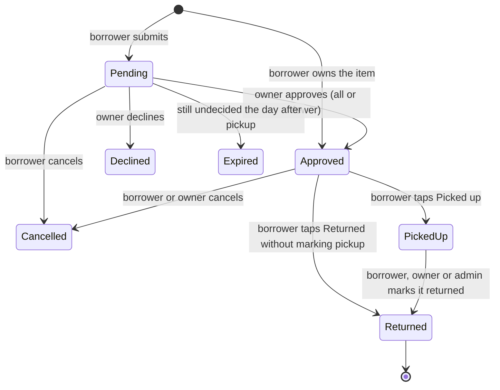

# PTA Asset Manager — Product Spec

Nov 12, 2026 · @Russ · Draft v0.3

## Overview

A small web app where PTA volunteers and staff browse the equipment the PTA owns (tables, chairs, coolers, extension cords, water jugs, the popcorn machine), see what is free on which days, and ask to borrow it for an event. Each item's owner approves the request, the borrower gets pickup instructions by email, and the borrower marks the items picked up and returned from their phone, leaving condition notes for the next person.

**Problem today:** nobody has a full list of what the PTA owns or where it is. Borrowing happens by asking around. Two events claim the same tables. Things come back broken or missing parts, and nobody hears about it until the next person opens the box.

**What the app does:** keeps the catalog (with photos) in one place, shows a calendar of who has what and when, sends each request to the right person to approve, and keeps a running condition history for every item.

It belongs with the PTA's other tools ([reimburse-me](https://github.com/MiralomaPTA/reimburse-me) and meeting-manager) and is built the same way: Next.js on Vercel's free tier, with every record in the PTA's Google Workspace (a Sheet, a Drive folder and Gmail), reached through a service account.

## Goals and non-goals

**Goals**

- A borrower can find an item, check it is free, and request it from a phone in under 3 minutes.
- An owner can approve or decline a request in one visit from the notification email.
- Anyone signed in can see what is available on a given day and what is already booked.
- Condition notes pass from one borrower to the next, and problems reach the owner the day they are reported.
- Zero added running cost: Vercel Hobby, GitHub Actions and the PTA's existing Google Workspace for Nonprofits.
- Sized for about 300 items and 50 requests a month at peak (fall festival season).

**Non-goals (for now)**

- Time-of-day bookings. Availability is by whole day.
- Tracking individual units. A stack of 40 chairs is one item with a quantity.
- Loan rules: maximum loan length, minimum notice, auto-approved items.
- Replacement value, purchase date and other bookkeeping fields.
- A separate "in repair" status. An owner takes broken units out of circulation by lowering the quantity, to 0 for a single item.
- Google Calendar sync, QR labels, deposits or fees, lending to outside groups.
- Consumable supplies (plates, napkins) that don't come back.

## Users and roles

| Role | Who | What they can do |
| --- | --- | --- |
| Borrower | Every approved user | Browse the catalog and calendar, submit requests, cancel their own requests, mark lines picked up and returned, write condition notes |
| Owner | An approved user named as the owner of one or more items. Not a role in the Users tab; it comes from the Items tab | Everything a borrower can do. Approve or decline request lines for their items, edit their items, mark their items returned for a borrower who forgot, clear problem flags |
| Admin | `role` = admin in the Users tab | Everything an owner can do, for every item. Approve new users, add and archive items, assign owners, decide lines for items with no owner, maintain the Locations and Event types tabs |

**Sign-in** works exactly as in reimburse-me: one-time links emailed to the user, no passwords, no Google account needed. Links last 15 minutes and work once; sessions last 30 days, and every page re-reads the Users row, so removing someone takes effect at once.

- An approved address gets a sign-in link, at most one a minute.
- An unknown address is shown a short form on screen: name, phone, and how they are connected to the school (parent, staff, volunteer, other). It is added to the Users tab as pending, and the admins get one email with a link to an Approve / Deny page. Nothing is emailed to the unknown address until it is approved. At most 20 new pending addresses are recorded a day.
- Admins can paste addresses into the Users tab as approved ahead of time (board members, room parents, event chairs) so they never wait.

The asset manager has its own Users tab in its own Sheet, separate from reimburse-me's, because the audiences differ: borrowers are mostly parents, and reimburse-me's users are mostly staff.

## How a request moves

1. **Browse.** The borrower filters the catalog by tag, location or "free between these dates", and adds items with quantities to a request, like a cart.
2. **Request.** They pick an event type, name the event, choose the pickup and return dates, and submit. One request can hold items with different owners.
3. **Decide.** Each owner gets an email listing their lines. On the decision page they approve each line (for fewer units if needed) or decline it with a note. Admins decide lines for items with no owner. A line for an item the borrower owns is approved automatically.
4. **Confirm.** Once every line is decided, the borrower gets one email: approved items grouped by location, each location's pickup instructions, the owners' notes and each item's contents checklist, plus any declined lines with the owner's note.
5. **Pick up.** The borrower opens the request page on their phone and taps *Picked up*, for each line or all at once.
6. **Return.** They tap *Returned*, answer "Everything OK?", tick off the contents checklist, add condition notes for the next person and, if something is wrong, a photo. A problem emails the owner.

Each request line has its own status:

A returned line carries an OK / problem flag. A problem stays open until the owner clears it with a note ("replaced the cord").

The request's status is worked out from its lines: *Waiting for approval* while any line is pending, *Approved* once all are decided and at least one is approved, *Out* while anything is picked up, and *Closed* when nothing is left to pick up or return.

## Functional requirements

### 1. Catalog

- A grid of item cards: photo, name, tags, location, and today's status.
- Search by name and description. Filter by tag (chips for every tag in use), by location, and by "free between [date] and [date]", which hides items with no units free on every day in that range.
- **Status today**, from the availability rules in section 3:
  - *Available*: every unit is free today.
  - *N of M available today*: some units are booked.
  - *Out, due back Oct 14*: every unit is booked or picked up.
  - *Overdue*: picked up and not returned after its return date.
  - *Not available*: quantity 0.
  - A *Problem reported* badge while a problem flag is open.
- **Item page:** photo, description, tags, location, owner, quantity, contents checklist, status today, a calendar of bookings, and the condition history. The history shows the three most recent return notes with date, borrower (first name and last initial) and OK/problem, and a "show all" link expands it. An open problem is shown as a banner at the top.

### 2. Calendar

- A timeline of every booking, one row per booking, filterable by tag, item and location. On a phone it shows two weeks at a time; on a wider screen, four. Today is highlighted and weekends are shaded.
- Below the timeline, a list of this week's pickups and returns, by day.
- Each booking is a bar from pickup date to return date, labeled with event name, borrower (first name and last initial) and items, e.g. "Fall Fest · Jane D. · 6 tables, 30 chairs".
- Approved and picked-up bookings are solid; pending ones are hatched and labeled *pending*; overdue ones are red.
- Each item page has the same calendar for that item alone.

### 3. Availability

- Dates are whole days, inclusive, in Pacific time. A line booked Oct 10–12 holds its units on the 10th, 11th and 12th, so equipment returned on the 12th can next go out on the 13th.
- On each day of its range, a line holds its approved quantity of the item while it is *Approved* or *Picked up*. A line past its return date and not yet returned also holds its units through today. Future days are not held for it, but owners see it flagged as overdue.
- Available on a day = item quantity − units held that day.
- Pending lines don't reduce availability. They show as tentative on the calendar and in the request form.

### 4. Requesting

- The request holds items and quantities. The form asks for:
  - Event type, from the Event types tab (PTA event, Signup party, Classroom, Other).
  - Event name.
  - Pickup date (today or later) and return date (on or after pickup).
  - An optional note to the owners.
- Each line shows how many units are available on the chosen dates. The borrower can't ask for more than the fewest units free on any day of the range. If pending requests overlap, the form says so: "2 other requests are pending for these dates (Spring Fling, Book Fair)".
- On submit the borrower sees a confirmation with the request ID and a link to the request page.
- A borrower can cancel the whole request, or any one line, until it is picked up. To change the dates or items, they cancel and request again.

### 5. Owner decisions

- An owner's *To decide* page lists pending lines for their items, oldest first. It also lists their items that are out or overdue, and open problem flags.
- The decision page for one request shows the borrower's name, email and phone, the event, the dates, and the borrower's note. For each of the owner's lines it shows:
  - The quantity requested and how many units are free on those dates.
  - Overlapping approved and pending bookings, with event and borrower.
  - A warning when approving the line would overbook any day: "Approving 30 would overbook Oct 12 by 10. Approved bookings hold 20 of 40." The owner can approve fewer, or confirm and overbook anyway.
- Actions per line: *Approve* (quantity defaults to the request; can be lowered) or *Decline* with a note. Plus one optional note to the borrower, which goes into the confirmation email.
- An owner or admin can cancel an approved line before pickup, with a note that is emailed to the borrower.
- Approve and decline buttons are never put in emails: link scanners would press them. The email links to the decision page, and a 30-day session means that is usually one tap.

### 6. Pickup and return

- The request page lists each line with its status and buttons: *Picked up* (per line, or *All picked up*) and *Returned* (per line, or *Return all*, which opens one form with a section for each item still out).
- **Pickup** records the time and shows the contents checklist so the borrower can see what should be there.
- **Return** asks:
  - "Everything OK?" Yes / There's a problem.
  - The contents checklist. Any unticked item turns the answer into a problem.
  - Condition notes for the next person. Optional when OK, required for a problem.
  - An optional photo.
  - The return date: today by default; can be set earlier for someone who forgot to tap.
- The location's return instructions are shown on the return form and in the return reminder ("Stack chairs on rack B, 10 per stack").
- A problem emails the owner (or the admins for an item with no owner) and puts a *Problem reported* banner on the item. The item stays requestable. The owner clears the flag with a note and can lower the quantity if something broke.
- Owners and admins can mark a line returned for the borrower. The return then records who marked it.

### 7. Managing items

- **Add / edit item:**
  - Name.
  - Description.
  - One photo, taken with the phone camera or chosen from files.
  - Tags: free text, with suggestions from tags already in use.
  - Location, chosen from the Locations tab.
  - Quantity.
  - Owner: an approved user; blank means the admins.
  - Contents checklist: one part per line, e.g. "Kettle", "Scoop", "Power cord".
- Admins add, edit and archive any item and assign owners. Owners edit their own items, everything except the owner field and archiving.
- **Archive** hides an item from the catalog and the request form, but keeps its history; admins can unarchive. Items are never deleted, because past requests refer to them.
- **Photos:** HEIC is converted and the image resized to at most 1600 px in the browser, which keeps uploads under Vercel's 4.5 MB request limit. The server makes a 400 px thumbnail with sharp and stores both in Drive. Each new photo gets a new file, so the app serves photos with long-lived cache headers.
- **First stocktake:** an `import-items` script loads a CSV and a folder of photos into the Items tab and Drive, so the initial inventory can be photographed in one session and loaded at once. The Items tab can also be edited by hand afterward.
- An admin *Needs attention* page lists items whose location isn't in the Locations tab or whose owner isn't an approved user, along with archived items that still have open bookings.

### 8. Notifications

All email comes from the app's Workspace account (see *Technical architecture*) with the From name "Miraloma PTA Equipment". Emails to a borrower about specific items set Reply-To to those items' owners, so a reply reaches a person.

**Sent when something happens:**

| When | To | Contents |
| --- | --- | --- |
| Someone asks for access | Admins | Name, phone, connection to the school; link to Approve / Deny |
| Access approved | The new user | A sign-in link |
| Request submitted | Borrower | Summary and a link to the request page |
| Request submitted | Each owner of a line; admins for lines with no owner | Their lines, the dates, any overbooking or pending-overlap warnings, a link to decide |
| Every line decided | Borrower | Approved lines grouped by location with pickup instructions, the quantity approved, contents checklists and owners' notes; declined lines with the reason |
| Owner cancels an approved line | Borrower | Which line, and the note |
| Borrower cancels | Owners of the cancelled lines that were pending or approved | Which lines |
| Returned with a problem | Owner; admins for an item with no owner | Notes, missing parts, photo, a link to clear the flag |

**Sent by the daily job:**

| Reminder | To | When |
| --- | --- | --- |
| Pickup | Borrower | The day before pickup: approved lines not yet picked up, still-pending lines, each location's pickup instructions. Skipped when the confirmation email went out the same day |
| Return due | Borrower | The day before the return date: lines not yet returned, each location's return instructions |
| Overdue | Borrower daily for 7 days, with the owner copied on days 1 and 3; after that, the owner and admins once a week | Every day after the return date that a line is still not returned, whether or not it was marked picked up |
| Stale request | Owner (admins for items with no owner) | When a line has been pending 2 days, then every 2 days. The day before pickup, admins are copied too |
| Expired | Borrower and owner | The day after the pickup date, for lines still pending; they become *Expired* |

## Technical architecture

The same shape as reimburse-me, with the daily job from meeting-manager:

- **Web app:** Next.js on Vercel's free (Hobby) tier. TypeScript, Tailwind and zod; vitest for unit tests. GitHub Actions CI runs typecheck, lint and tests on every push.
- **Adapters:** `ADAPTERS=local` writes JSON and files under `./.data` for development, with emails saved to `.data/outbox/`. `ADAPTERS=google` uses Workspace. A production build refuses to run with local adapters.
- **Workspace access:** a service account with domain-wide delegation acts as a new dedicated account, **equipment@miralomasf.com**, with the Drive, Sheets and `gmail.send` scopes. Use a new service account rather than reimburse-me's, so a leaked key exposes one app, not both.
- **Daily job:** a scheduled GitHub Actions workflow runs `npm run tick` straight against Google with the credentials in repository secrets. It doesn't call the Vercel app. This copies meeting-manager's `tick.yml` / `run-job.yml`:
  - It runs at 15:00 UTC, which is 7 am PST and 8 am PDT.
  - Manual runs (`workflow_dispatch`) take `today` and `dry_run` inputs.
  - A concurrency group stops two runs overlapping.
  - Each run commits a one-line run log to `runs/`, which also keeps GitHub from disabling the schedule after 60 days without activity.

  Running the script directly avoids exposing a public cron endpoint and Vercel's function time limit, and gives dry runs and replays for free. The cost is that the Google credentials live in both Vercel and GitHub secrets.
- **Idempotent reminders:** every reminder is recorded in a *Sends* tab under the key `kind + line ID + due date` and never sent twice. GitHub can start scheduled runs late or skip them, so each run also catches up on anything still relevant: a pickup reminder until the pickup date, a return reminder until the return date. Overdue and stale reminders recur on their own.

**The Sheet** ("PTA equipment"), one tab each:

| Tab | One row per | Key columns |
| --- | --- | --- |
| Items | Item | id, name, description, tags (comma-separated), location, quantity, owner_email, contents (one part per line in the cell), photo_id, thumb_id, archived, created_at, updated_at |
| Locations | Place | name, address, pickup_instructions, return_instructions |
| Event types | Type | name, active |
| Users | Person | email, name, phone, connection, status (pending / approved / denied), role (borrower / admin), requested_at, decided_at, decided_by, last_link_at, signed_in_at |
| Requests | Request | id, created_at, borrower_email, event_type, event_name, pickup_date, return_date, borrower_note, confirmed_at (when the all-decided email went out) |
| Lines | Request line | id (request ID + number, e.g. R-0142-2), request_id, item_id, item_name, qty_requested, qty_approved, status, decided_by, decided_at, decision_note, owner_note, cancelled_at, cancelled_by, cancel_note, picked_up_at, returned_on, returned_at, returned_by, return_ok, return_notes, missing_parts, return_photo_id, problem_cleared_at, problem_cleared_by, problem_cleared_note |
| Activity | Change | at, actor_email, action, request_id, line_id, item_id, detail |
| Sends | Reminder sent | key, kind, sent_at, to, line_ids |

- **Editing the Sheet by hand:**
  - The app finds rows by ID and columns by header name, so sorting, filtering and adding columns are safe; renaming a header breaks it. The app writes missing headers on first use and appends new ones at the end of the row, as reimburse-me does.
  - Items refer to a location and an event type by its name. Renaming a location in the Sheet means updating the items that use it; the *Needs attention* page lists any it misses.
  - Status changes go through the app, which sends the emails and writes the Activity row. A status typed into the Sheet sends nothing.
- **Reads and quota:**
  - Each page reads every tab it needs in one `batchGet`. All calls run as one Workspace user, and Sheets allows about 60 reads a minute per user, so one call per page view matters.
  - A short in-memory cache (a few seconds, cleared on every write) smooths out bursts.
  - At this size the whole Sheet is well under a megabyte.
- **Writes:** Sheets has no transactions. Before changing a line, the app re-reads its row and checks that the status is still what the page showed. If not, the user sees "this request changed; reload". New rows are appended.
- **Drive:** a folder "PTA equipment" owned by equipment@, with `photos/` (item photos and thumbnails) and `returns/` (return photos). Photos are never shared publicly: the app serves them through a route that requires a signed-in session.
- **Ownership:** code in the MiralomaPTA GitHub organization; the Vercel project in an account under equipment@miralomasf.com.

### Screens

| Path | What |
| --- | --- |
| `/` | Sign in, or the catalog once signed in |
| `/items/[id]` | Item page |
| `/calendar` | Calendar of all bookings |
| `/request` | Current request (cart) and the request form |
| `/requests`, `/requests/[id]` | My requests; one request with pickup and return actions |
| `/review` | Owner and admin: lines to decide, items out and overdue, open problems |
| `/review/[requestId]` | Decision page for one request |
| `/items/new`, `/items/[id]/edit` | Add or edit an item |
| `/admin` | Admin: needs attention, archived items |
| `/auth/*` | Sign-in callback, pending page, access approval page |
| `/help` | How borrowing works, for borrowers and owners |

## Data, privacy and retention

- **What we store:** names, emails, phone numbers, each user's connection to the school, event names and dates, condition notes, item and return photos.
- **Who sees what:**
  - All approved users see the catalog, the calendar, and the condition history, with borrowers shown by first name and last initial.
  - A borrower's full name, email and phone are visible only to the owners of the items they requested, and to the admins.
  - A borrower sees only their own requests in full.
- **Where:** the Sheet and the Drive folder, owned by equipment@miralomasf.com and shared with the admins. The app keeps nothing of its own.
- **Retention:** keep everything indefinitely. Condition history is the point.

## Rollout plan

1. **Phase 0: Setup.**
   - Create equipment@miralomasf.com.
   - In the PTA's Google Cloud project, enable the Drive, Sheets and Gmail APIs, create a new service account, and have the super admin authorize its domain-wide delegation.
   - As equipment@: create the Drive folder and the Sheet (the app creates any missing tabs), and fill in Locations and Event types.
   - Create the Vercel project, add the GitHub repository secrets and variables, and add the DNS record.
2. **Phase 1: MVP.**
   - Sign-in with access approval.
   - Catalog, item pages and the calendar.
   - Adding and editing items with photos, and the `import-items` script.
   - Requests, owner decisions, pickup and return with condition notes and the problem flag.
   - Every event-driven email.
   - Stocktake: photograph and load the inventory.
   - Pilot with the events committee for one event.
3. **Phase 2: Daily job.** Pickup, return, overdue, stale and expired reminders in GitHub Actions.
4. **Later, if wanted:** QR labels that open an item's page, Google Calendar sync, editing a request in place, loan rules, a repair status, replacement values.

Success measures: share of borrowing that goes through the app, double-bookings (target zero), items returned with problems that were then fixed, and days from request to decision.

## Decisions

| Topic | Decision |
| --- | --- |
| Who can browse and request | Approved users only; sign-in by one-time email link; new addresses approved by admins |
| Users list | Its own Users tab, separate from reimburse-me |
| Approval | Per-item owner; admins decide for items with no owner |
| Multi-item requests | One request holds many items; each owner decides their own lines; the borrower gets one confirmation once every line is decided |
| Catalog editing | Admins edit everything and assign owners; owners edit their own items |
| Locations | A fixed list in the Locations tab, each with pickup and return instructions |
| Item fields | Name, description, one photo, tags, location, quantity, owner, contents checklist |
| Multiples | Pooled count per item; condition notes shared across the pool |
| Dates | Whole days, inclusive; no times |
| Overlaps | Only approved and picked-up lines reduce availability; pending lines are shown as tentative; owners are warned before approving an overbooking |
| Calendar privacy | Event name and borrower's first name and last initial, visible to all approved users |
| Purpose | Event type from a list, plus an event name |
| Pickup and return | The borrower marks them on the request page; owners and admins can mark a return for the borrower |
| Problems on return | Flag, optional photo, email to the owner; a banner on the item until the owner clears it |
| Reminders | Pickup, return due, overdue, stale request, expired, sent by a GitHub Actions daily job, not Vercel cron |
| Workspace account | A new account, equipment@miralomasf.com, with its own service account |
| Google Calendar | No; the app's own calendar only |
| Hosting | Vercel Hobby; code in the MiralomaPTA GitHub organization. Hobby is meant for personal, non-commercial use; reimburse-me already runs there under the same reasoning. Revisit if Vercel objects |
| Hostname | equipment.miralomasf.com |
| Budget | Zero added cost |
| Volume | About 300 items and 50 requests a month at peak |
| Access approval | Every admin gets the email; the first to act decides |
| Phone number | Required when asking for access, so owners can text about pickup |
| Partial approval | Allowed: an owner can approve fewer units than requested |
| Owner borrowing own item | Approved automatically |
| Undecided at pickup | Lines still pending the day after the pickup date expire, and the borrower and owner are told |
| Approved but never picked up | Treated as overdue after the return date; the borrower can tap *Returned* or cancel the line |
| Editing a request | Not in the MVP; cancel and request again |
| Request ID | Sequential, e.g. R-0142 |
| Condition history shown | The three most recent returns, with "show all" |

## Open questions

None.

## Changes since v0.1

- Accepted every proposed default from the open questions and moved them into *Decisions*.

## Changes since v0.2

- **Calendar:** a timeline, two weeks on a phone and four on a wider screen, with this week's pickups and returns listed below it, as in the mockups. Replaces the month view and the phone list.
- **Return all:** the request page can return every item still out in one form, with a section per item.
- **Columns added while building:**
  - Users: `signed_in_at`, which makes each sign-in link work once (as in reimburse-me).
  - Lines:
    - `owner_note`: the owner's one note to the borrower.
    - `cancelled_at`, `cancelled_by`, `cancel_note`: who cancelled and why, kept apart from the decision.
    - `returned_on`: the day it came back, which can be earlier than when it was marked.
- **Sheet status:** the picked-up status is written as "Picked up" rather than "PickedUp". The app reads either.
